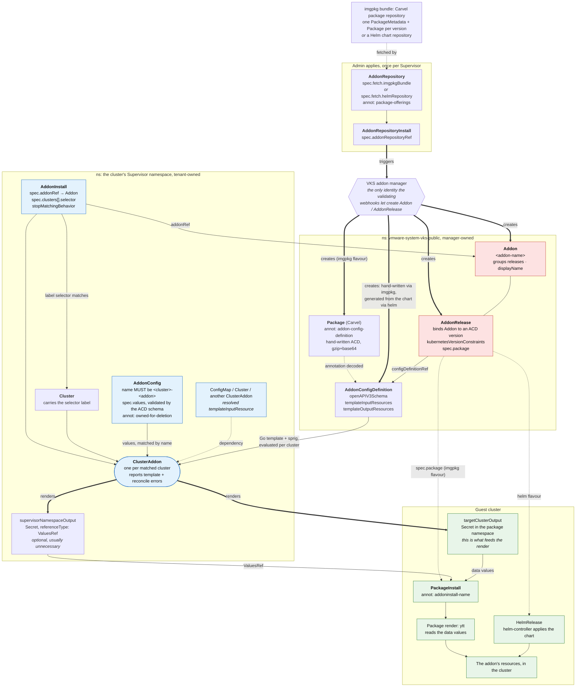

# Working with VKS addons

Hard-won, verified knowledge of the VKS addon system. Facts here were checked against a
live Supervisor and guest cluster (VKS 3.7, and VKS 3.8.0 on Supervisor 9.1.1.0 where a
fact changed; see *What changed in VKS 3.8*). Where something is inferred rather than
tested, it says so. Trust shipped definitions over CRD field descriptions, which are
sometimes stale.

## The resource model

Eight kinds under `addons.kubernetes.vmware.com`, in three groups. Red is manager-owned
and webhook-locked, blue is tenant-created, green is inside the workload cluster.



Manager-owned, created for you, live in `vmware-system-vks-public`:

- **AddonConfigDefinition (ACD)**: the addon's contract. `openAPIV3Schema` is the
  tenant-facing values schema; `templateOutputResources` is what it renders per cluster;
  optional `templateInputResources` declares Supervisor objects to read (a `ConfigMap`,
  a `Secret`, the `Cluster`, another addon's `ClusterAddon`); `spec.addonInstallPermission.accessPolicies`
  grants the rights for those reads and writes.
- **Addon**: groups releases of one addon. Mostly metadata (`displayName`, `description`).
- **AddonRelease**: binds an `Addon` to an `AddonConfigDefinition` version, carries
  `kubernetesVersionConstraints`, and may carry `spec.package`. If it has `spec.package`,
  the guest gets a PackageInstall; if not, the addon is package-free. `spec.dependsOn`
  gates install on other addons being installed (see *Cross-addon dependencies*).

Admin- or tenant-creatable, the levers you actually pull:

- **AddonRepository** + **AddonRepositoryInstall**: an admin creates these; the manager
  reconciles them and materialises the three kinds above. This is the only way to get
  them created (see constraints). Still true on VKS 3.8 with Supervisor 9.1.1.0: the
  Supervisor administrator's RBAC allows `create` on these two kinds in every namespace,
  and on no Addon, AddonRelease or ACD anywhere.
- **AddonInstall**: a tenant attaches an addon to clusters via a label selector.
  References the `Addon` by `spec.addonRef`. Created in the cluster's Supervisor namespace.
  `stopMatchingBehavior` decides whether the addon's resources are removed or left behind
  when a cluster stops matching the selector. With `crossNamespaceSelection: Allowed`, one
  AddonInstall selects clusters in **every** namespace. There is one for telegraf,
  `vcfops-telegraf-addoninstall` in `vmware-system-vks-public`, selecting
  `addons.kubernetes.vmware.com/automated-monitoring=enabled`. Its field manager is
  `manager`, the same name the VKS addon manager writes AddonReleases with, so who creates
  it is not known. It need not live in the public namespace: secret-store's
  `vault-injector-global-installer` sits in its Supervisor Service namespace and serves
  clusters in ten others. The cluster label then is the only per-cluster switch, and no
  namespace needs its own AddonInstall.

  A cross-namespace AddonInstall does **not** react to a cluster gaining the label.
  Verified: two clusters labelled after the AddonInstall last reconciled had no
  ClusterAddon after 5 minutes. Touching the AddonInstall (any annotation) made them at
  once, and a namespaced AddonInstall in the cluster's own namespace made one at once. How
  long the cross-namespace one takes on its own was not measured.
- **AddonConfig**: per-cluster values, validated against the ACD schema. Must be named
  `<cluster-name>-<addon-name>` — that name is how the system pairs config to cluster — in
  the cluster's Supervisor namespace, with annotation
  `clusteraddon.addons.kubernetes.vmware.com/owned-for-deletion: "true"` so it is garbage
  collected with the ClusterAddon. `spec` has exactly three fields —
  `addonConfigDefinitionRef`, `clusterName`, `values` — so there is **no** `secretRef` or
  `valuesFrom`: an AddonConfig cannot point at a Secret. A Secret reaches the render only
  if the ACD declares it as a `templateInputResource`. Do not set `spec.clusterName`
  yourself; the addon system sets it and warns when a client does. An AddonConfig need not
  be tenant-written: telegraf's (`<cluster>-telegraf`) is created by a Supervisor-side
  controller, owned by the ClusterAddon, with values (the Metrics Aggregator's
  LoadBalancer IP) that differ from the ACD defaults.

Created for you per matched cluster, and the thing to actually debug:

- **ClusterAddon**: one per cluster the `AddonInstall` selector matched. This is where the
  ACD's output templates evaluate, against that cluster's `AddonConfig`, so template errors
  surface in *its* conditions, per cluster, rather than anywhere upstream.

**Two writers can share one AddonConfig with server-side apply.** `spec.values` is
`x-kubernetes-preserve-unknown-fields`, and SSA tracks ownership per nested map key inside
it. Verified with two field managers on one AddonConfig: `argocd-controller` applied
`helmValues.aggregator.replicaCount`, a controller applied `helmValues.vcfOps.*`, Argo
re-applied its manifest without `vcfOps` and the controller's keys stayed, and Argo then
setting `vcfOps.clientId` was refused:

```
error: Apply failed with 1 conflict: conflict with "platform-observability-service": .spec.values.helmValues.vcfOps.clientId
```

Rules: split by key, never inside a list (a list is one atomic field); each writer applies
with its own `--field-manager`; the controller applies with `force` so it always reclaims
its own keys. Argo CD's server-side sync forces conflicts, so a controller-owned key that
appears in Git is taken over silently — keep those keys out of Git, and give the
Application `ServerSideApply=true` and `ServerSideDiff=true` so the controller's keys do not
show as drift. The addon manager also updates AddonConfigs (field manager `manager`) but
owns nothing under `spec.values`. Whoever creates the object decides what a delete takes
with it: if Argo CD prunes the AddonConfig, the controller's keys go too.

## What changed in VKS 3.8

VKS 3.8.0+v1.37 (October 2026). Each item says whether it was checked on a live Supervisor
(VKS 3.8.0, Supervisor `v1.34.9+vmware.1-vsc9.1.1.0`) or comes from the release notes only.
The sections below are updated where 3.8 changes them.

Verified live:

- **Helm AddonRepositories propagate from any namespace, Supervisor Service namespaces
  included.** The 3.7 failure (*Supervisor Service packages get their namespace rewritten*,
  below) is gone. The manager now copies the repository ConfigMap into
  `vmware-system-vks-public` as `<install-name>-config-<namespace prefix>-<hash>`, and the
  single builtin `helm-repo` addon (ACD `helm-repo-1.0.1`, which still reads only
  `vmware-system-vks-public`) renders the guest `HelmRepository` from it. No per-namespace
  `helm-repo-<namespace>` addon is built any more; one left over from 3.7 stays as an
  orphan Addon with no release. An install that failed under 3.7 turned
  `PropagationMetadataResourcesReconciled=True` on its own after the upgrade, and the guests
  got the `HelmRepository` and installed the chart. The release notes do not mention this.
- **A helm chart can carry its own ACD.** Same annotation and encoding as a Carvel Package:
  `addons.kubernetes.vmware.com/addon-config-definition` in `Chart.yaml`, gzip+base64 ACD
  YAML. The builtin 3.8 `tekton-operator` and `external-secrets` charts both do this. See
  *Helm charts with their own ACD*, below.
- **Chart metadata feeds the addon CRs.** `Chart.yaml` `kubeVersion` becomes
  `AddonRelease.spec.kubernetesVersionConstraints` (`>= 1.19.0-0` on external-secrets). A
  third-party chart's `description` became its `Addon.spec.description`; the builtin helm
  Addons carry only their name there, so the rule is not clear. Every helm AddonRelease gets
  `spec.chart` (`name`, `version`, plus `digest` for an OCI chart) and
  `dependsOn: [{addonRef: {name: helm-controller}}]` without the chart asking for it. The
  release notes add `icon` and `dependencies` (dependencies between add-ons); not checked.
- **OCI helm sources.** `spec.fetch.helmRepository.url` accepts `oci://`. The builtin helm
  repositories are `oci://projects.packages.broadcom.com/vsphere/supervisor/vks-standard-packages/<version>/vks-addons-helm`
  and the depot mirror `oci://depot.kube-system.svc/vcf/vks-standard-packages/ga/<version>/vks-addons-helm`.
  Their AddonReleases pin `spec.chart.digest`. A server dry run of an `oci://` repository is
  admitted. The guest `HelmRepository` gets `spec.type` from the repository ConfigMap.
- **`package-offerings` is optional on a helm AddonRepository and still required on an imgpkg
  one.** Server dry runs without the annotation: both `helmRepository` forms are admitted,
  and `imgpkgBundle` is still rejected with `metadata.annotations.addons.kubernetes.vmware.com/package-offerings: Not found`.
  The builtin 3.8 helm repositories carry none.
- **VKS ships its own helm addons.** `builtin-helm-addonrepository-3.8.0` (plus its depot
  mirror) registers `external-secrets` and `tekton-operator` as helm addons, with
  hand-written ACDs, alongside the Carvel `builtin-addonrepository-3.8.0`.
- **AddonConfigDefinition is locked now too.** See the hard constraints below.
- **Two new Supervisor-side kinds.** `ConfigExport` publishes (part of) a Supervisor object
  as a ConfigMap in `vmware-system-vks-public` (`spec.source`, `spec.extract`, `spec.toName`,
  `spec.serviceAccountName`; the source is any kind, such as `ConfigMap`, `Service` or
  `SupervisorProperties`); VKS ships three, such as `supervisor-apiserver-endpoints` in
  `kube-system`. `CertificateExport` copies a Supervisor cert-manager `Certificate` (or a CA
  bundle from a ConfigMap) into a guest cluster as a Secret, and keeps it in sync through
  renewals (`spec.clusterName`, `spec.source`, `spec.target`, `spec.serviceAccountName`).
  The Supervisor administrator can only read both kinds. CertificateExport does not copy an
  arbitrary Secret; whether ConfigExport takes a Secret source is not tested, and its
  output is a ConfigMap in a public namespace either way.

From the release notes only, not tested here:

- The same chart name can be registered in several AddonRepositories.
- Private helm registries: credentials are optional, and without them the registry is
  treated as anonymous. Known issue: such an AddonRepositoryInstall fails authentication
  until at least one VKS cluster exists on the Supervisor. The repository ConfigMap names
  `<repository>-auth` and `<repository>-cert` Secrets, so those are probably the names it
  reads (inferred).
- `addonrepository.addons.kubernetes.vmware.com/global-image-registry`, an annotation that
  injects a registry URL into the addon's images.
- CRDs in a helm chart are installed and updated on addon upgrades.
- `helmOptions.install.createNamespace` can be turned off in an AddonConfig.
- ACD templates may use Go template expressions in output labels and annotations.
- For Kubernetes releases 1.37 and later, the core addons are managed by this addon
  framework instead of ClusterBootstrap, legacy addon resources are ignored, and
  ClusterBootstrap creation is blocked. The `vcf package` CLI plugin is deprecated in favour
  of `vcf addon`.
- Known issue: after an upgrade, an AddonRepositoryInstall may report Non-Ready, caused by
  cascading helm chart metadata fields to Addon objects. The workaround is Broadcom
  Support.
- Known issue: add-on manager memory grows with clusters times helm addons. The documented
  caps are 600 helm-based addons in total at up to 300 clusters, and 100 at up to 500.

## The hard constraints (the expensive lessons)

**Addon and AddonRelease are manager-locked.** Validating webhooks
(`addon.validating.vmware.com`, `addonrelease.validating.vmware.com`) reject every
mutating operation on them from any client that is not the VKS addon manager's own
service account. RBAC does not help: a service account with `create` still gets denied at
admission, and create, update, client-side apply and server-side apply all fail
identically. The manager runs with `--enable-webhook-client-verification`; the check is on
caller identity. Errors look like:

```
Addon is a managed resource and CREATE is not allowed
operation on an AddonRelease is only allowed from VKS addon manager service account
```

On VKS 3.8 the Addon webhook also pins the namespace. A create from a Supervisor Service
(kapp, so in the service namespace) was refused on that before any identity check showed:

```
admission webhook "addon.validating.vmware.com" denied the request:
  Addon.addons.kubernetes.vmware.com "<name>" is invalid: metadata.namespace:
  Unsupported value: "svc-<name>-<id>": supported values: "vmware-system-vks-public"
```

**AddonConfigDefinition is locked too, from VKS 3.8.** On 3.7 you could create an ACD
directly, but it was inert alone: nothing consumes one that is not selected by an
AddonRelease, and an AddonInstall requires the Addon to reconcile ("The Addon must be
created to reconcile the AddonInstall"), with no field pointing at an ACD. On 3.8 the
create itself is refused, verified from a Supervisor Service:

```
admission webhook "addonconfigdefinition.validating.vmware.com" denied the request:
  addonconfigdefinitions.addons.kubernetes.vmware.com is forbidden:
  operation on an AddonConfigDefinition is only allowed from VKS system service accounts
```

*This is what blocks the package-free, fetch-free design*, which is otherwise the better
one and worth knowing about: a Supervisor Service lays down the ACD, the Addon, and an
AddonRelease carrying `addonConfigDefinitionRef` and **no `spec.package`**, with the last
`templateOutputResource` being a kapp-controller `App` with an `inline` fetch carrying the
payload. Tenants attach it with AddonInstall + AddonConfig exactly as normal. No Carvel
package, no guest image pull, no registry in the path at all. Every piece of it works
today except creating the Addon and AddonRelease.

It becomes viable if any of: the webhook is relaxed to admit RBAC-authorized callers; a
supported path appears for a non-manager principal to create a package-free Addon +
AddonRelease; or AddonInstall gains a direct ACD reference, removing the need for both.
Re-test with the token probe below — if a non-manager service account can create an
AddonRelease, the design is back on the table.

A change letting privileged users (the SSO administrators) create Addons, AddonReleases,
ACDs and AddonInstalls directly in `vmware-system-vks-public` was described to us as
coming, but is not in the VKS 3.8 release notes, and on VKS 3.8 with Supervisor
`vsc9.1.1.0` it is not there: the administrator has no RBAC for it, and the webhooks
refuse a Supervisor Service. Even once it lands, a Supervisor Service cannot use it
directly, because kapp moves everything out of `vmware-system-vks-public`; it would take a
runtime controller, or an administrator applying the objects.

**The only route to create the three kinds is an AddonRepository.** Two flavours:

- `fetch.imgpkgBundle`: a Carvel package repository. The manager reads the Package(s) and
  creates the addon CRs. The AddonRelease gets `spec.package` set, so the guest gets a
  PackageInstall. This preserves a hand-written ACD (it travels in a Package annotation).
- `fetch.helmRepository`: the AddonRelease is package-free, and `helm-controller` becomes
  a dependency. The ACD comes from the chart's `addon-config-definition` annotation when it
  has one (VKS 3.8, see *Helm charts with their own ACD*), and is otherwise generated with
  a fixed `helmValues`/`helmOptions` schema. The URL is an `https://` chart index or, from
  3.8, an `oci://` registry. `spec.addonFilters` (helm only) narrows which charts and
  versions off the upstream index get reconciled —
  `[{name: external-secrets, versions: ["2.8.0"]}]` against `https://charts.external-secrets.io`.
  On 3.7 it does not exempt the repository from the `package-offerings` annotation; on 3.8
  a helm repository needs no annotation at all.

The generated helm ACD, for a chart without its own, verified on a live one
(`<addon>.<version>`, the same on 3.7 and 3.8): schema is
`helmOptions` (only `targetNamespace`, default `default`) and `helmValues`
(`x-kubernetes-preserve-unknown-fields`); **no `templateInputResources`**; two outputs:

| output | name | what the template does |
|---|---|---|
| `targetClusterOutput` Secret, `referenceType: ValuesRef`, ns `vmware-system-helm` | `{{.Cluster.name}}-{{.Addon.name}}-values` | `stringData.values.yaml` = `.Values.helmValues \| toYaml`, nothing else |
| `supervisorNamespaceOutput` ConfigMap, `referenceType: Direct` | `{{.Cluster.name}}-{{.Addon.name}}-options` | `data` = `.Values.helmOptions` |

So with a helm repository the AddonConfig's `helmValues` is the **only** way per-cluster
data reaches the chart, secrets included, and it lands there in plain text. The guest
HelmRelease reads the values Secret through `valuesFrom` with `interval: 10m` and does
not watch it: an AddonConfig change reaches the guest Secret within seconds, but the
release is upgraded only on the next interval (measured: about 9 minutes). Plan for that
lag when a value is a credential that the old value stops working the moment it changes.

| | `imgpkgBundle` | `helmRepository` |
|---|---|---|
| ACD | yours, shipped in the `Package` annotation as gzip+base64 | generated, fixed `helmValues`/`helmOptions` schema; from 3.8 yours, in the `Chart.yaml` annotation |
| Tenant API | whatever schema you write | helm values (3.8: your schema over them) |
| Guest mechanism | `PackageInstall` -> ytt -> kapp | `HelmRelease` via helm-controller |
| `AddonRelease.spec.package` | set | not set |
| Dependencies | kapp-controller only | helm-controller must be installed |
| Version selection | the versions in the bundle | `spec.addonFilters` |
| Source | imgpkg bundle in an OCI registry | chart index over `https://`; from 3.8 also `oci://` |
| `package-offerings` | required | required on 3.7, optional on 3.8 |

**An AddonRepository is frozen once an AddonRepositoryInstall references it.**
`addonrepositories.validating.vmware.com` permits only `spec.addonFilters` to be modified
after that, and `addonFilters` is a `helmRepository` field — so an **imgpkg
AddonRepository is immutable outright**, `spec.fetch.imgpkgBundle.imageURL` included.
Verified: a server-side dry run changing only `imageURL` was rejected with

```
AddonRepository is in use by an AddonRepositoryInstall
```

The rejection is on the **update operation, not on the change**: a patch re-applying the
annotation's *existing, identical* value is refused just the same. `kubectl apply` of an
unchanged manifest is a client-side no-op and never reaches admission, so re-applying is
safe; anything that computes a real diff is not.

Deletion is *not* blocked; only update is. So there is no way to repoint an existing
registration at a new bundle. Superseding a repository means creating a **new
repo+install pair** with a distinct name **and** a distinct `spec.targetRepositoryName`,
moving consumers onto it, then deleting the old pair. This is what ships: VKS keeps
`standard-packages` 3.6 registered alongside `vks-addons-3.7.0`.

`spec.targetRepositoryName` names the backing Carvel `PackageRepository`. Two different
catalogs must not share one; reuse it only for mirrors of the same catalog. Object names
cannot contain a dot, so a version-suffixed name needs dashes
(`dayzero-addon-repo-1-1-0` for catalog `1.1.0`).

**But the image under a registration is not frozen — the tag is re-resolved.** The backing
`PackageRepository` stores the *tag*, not the digest, and re-fetches on its own. Verified:
a bundle pushed to an already-registered tag was picked up **569s** later (no explicit
`syncPeriod`), and the manager materialised an `AddonRelease` *and* an ACD for the package
version the new bundle added, with no CR touched. Combined with `package-offerings` being
unenforced, that gives the **rolling catalog** pattern:

- register **one permanent pair** whose `imageURL` is a floating tag (`:stable`), whose
  names carry no version, and whose offerings annotation names the package with
  `"versions": []`;
- publish each new package version to the bundle behind that tag (plus an immutable
  snapshot tag for provenance);
- every registered repository picks it up within ~10 minutes, with no admin action and no
  new CRs, forever.

The cost is that the registration no longer identifies what it serves, so keep the catalog
**append-only** — freeze each published package's YAML — or a moved tag can silently
redefine a version consumers are pinned to. `warroyo/dayzero-addon-service` implements
this end to end.

Practical consequence for a Supervisor Service wrapper: either make the CRs
release-independent as above, so an upgrade re-applies them unchanged and kapp skips them,
or give them version-suffixed names so an upgrade *replaces* the pair (kapp delete +
create, both allowed). What you cannot do is let a version-bearing field change under a
constant name — that is the update the webhook rejects.

**The guest fetch is unavoidable with imgpkg.** `spec.package` forces a guest
PackageInstall, and the guest acquires the package through a repository that fetches a
bundle. There is no package-free-and-fetch-free path through the addon system. Where the
guest fetches from depends on the repository: the builtin VKS repositories resolve to the
in-cluster depot (`depot.kube-system.svc`, a headless Service the guest also carries, backed
by the regional Harbor), while a custom AddonRepository is fetched from whatever URL it
names — verified, a guest pulled a custom bundle straight from `ghcr.io`. So an air-gapped
guest needs its own route to a custom repository's registry; the depot does not cover it.

`mgmt-image-proxy.kube-system.svc.cluster.local` is **not** part of this path. It is an
nginx virtual host on the Supervisor control plane that relays read-only pulls to the
management-network registry holding Supervisor Service images, and only Supervisor Service
vSphere Pods use it. It has no upstream to the depot, and a guest carries no reference to it.

**Supervisor Service packages get their namespace rewritten.** A Supervisor Service is
deployed with kapp's namespace rewrite, so every namespaced resource it applies lands in
the service's own namespace (`svc-<name>-<id>`), not where the YAML says. Cluster-scoped
resources are exempt. The manager does reconcile an AddonRepository/AddonRepositoryInstall
created in a service namespace, so a thin Supervisor Service wrapping those two CRs works.
On VKS 3.8 that holds for both fetch flavours. **On VKS 3.7 a `helmRepository` one only
half works there**, as follows.

Verified on VKS 3.7, fixed in 3.8 (see *What changed in VKS 3.8*). From a service namespace, the manager still creates the Addon, the
AddonRelease and the generated ACD, and an AddonInstall can select clusters. But a helm
addon also needs its Flux `HelmRepository` in every guest (`vmware-system-helm`), and that
never arrives. The guest's HelmRelease waits with:

```
HelmChart 'vmware-system-helm/vmware-system-helm-<cluster>-<addon>' is not ready:
  failed to get source: HelmRepository.source.toolkit.fluxcd.io "<targetRepositoryName>" not found
```

Why. The manager writes one ConfigMap per helm AddonRepositoryInstall,
`<install-name>-config`, labelled `addons.kubernetes.vmware.com/helm-repo=true`, in the
install's namespace. The builtin `helm-repo` addon (AddonInstall `helm-repo`, ACD
`helm-repo-1.0.0`) renders a `HelmRepository` into every cluster from those ConfigMaps. Its
`templateInputResources` read them **only from `vmware-system-vks-public`**. For any other
namespace, the manager builds a per-namespace copy: an Addon `helm-repo-<namespace>`, then
its ACD, AddonRelease and AddonInstall. The ACD grants access to that namespace in
`spec.addonInstallPermission`, and the ACD webhook rejects it for a third-party service
namespace:

```
admission webhook "addonconfigdefinition.validating.vmware.com" denied the request:
  AddonConfigDefinition "helm-repo-<namespace>-1.0.0" is invalid:
  spec.addonInstallPermission[*]: target namespace '<namespace>' in access policies is not the
  cluster namespace or one of the public namespaces (vmware-system-vks-public or kube-public)
  or a supervisor service namespace
```

So the Addon `helm-repo-<namespace>` exists, and nothing after it does. The
AddonRepositoryInstall reports `Ready=False` with `PropagationMetadataResourcesReconciled=False`,
`failed to create/update propagation metadata ACD`. The namespace *is* a Supervisor Service
namespace (`managedBy: vSphere-AppPlatform`, `appplatform.vmware.com/serviceId`), so the
webhook's test for one is something else; what, is not visible. On 3.7 a helm
AddonRepository therefore belongs in `vmware-system-vks-public`, and a Supervisor Service
cannot put it there: the namespace rewrite above moves it out. On 3.8 the manager copies
the ConfigMap into `vmware-system-vks-public` instead, and the same install works.

kapp and the manager also fight over a helm AddonRepositoryInstall that kapp deploys. The
manager adds the label `addons.kubernetes.vmware.com/helm: "true"` and the annotations
`addons.kubernetes.vmware.com/addon-repository-version` and `.../target-repository-name`.
kapp's next sync removes them, and the AddonRepositoryInstall webhook refuses, so the
service's PackageInstall goes to `Reconcile failed`:

```
only addon manager service account is allowed to modify VKS-managed labels/annotations
(kubernetes.vmware.com/managed-by, addons.kubernetes.vmware.com/pkgr-type,
addons.kubernetes.vmware.com/addon-repository-version)
```

Still the case on VKS 3.8, with the same refusal. A kapp `rebaseRule` that keeps those keys
from the live object should fix it (not tested).

**Placement and required labels/annotations.**
- The three addon kinds must be in `vmware-system-vks-public`.
- Each must carry `addon.kubernetes.vmware.com/addon-name` = the addon name (webhook
  rejects without it). Shipped addons also carry `addon.kubernetes.vmware.com/addon-namespace`.
- An AddonRepository must carry `addons.kubernetes.vmware.com/package-offerings` (a JSON
  listing of packages/versions it offers) or the webhook rejects it. It is **declarative,
  not enforced**: the manager materialises whatever the bundle actually contains and never
  checks it against the annotation. Verified — a repository whose annotation listed one
  package version, pointed at a bundle carrying two, reconciled `Ready=True` with no error
  and materialised an AddonRelease *and* an ACD for **both**, including the version the
  annotation omitted. So treat it as advertising copy (it is what the shipped repos'
  catalog listings are built from), not as a gate. Every shipped repository does keep it
  exact — the builtin lists all 22 of its packages with no version mismatches — and it is
  frozen after install, so a stale one cannot be corrected in place. Generate it from the
  same list that assembles the bundle. Shape:
  ```json
  {"repositoryVersion":"1.1.0",
   "packages":{"dayzero.kubernetes.vmware.com":{"versions":["1.0.1","1.0.2"]}}}
  ```
  Required for **both** fetch flavours — the check is on the kind, not on `spec.fetch`.
  Verified: a server dry run of an `imgpkgBundle` repository and of a `helmRepository`
  one, annotation omitted, are rejected identically with
  ```
  The AddonRepository "<name>" is invalid:
    metadata.annotations.addons.kubernetes.vmware.com/package-offerings: Not found
  ```
  That is VKS 3.7. On VKS 3.8 a `helmRepository` AddonRepository without the annotation is
  admitted (server dry run, both `https://` and `oci://`), and the builtin 3.8 helm
  repositories carry none; an `imgpkgBundle` one is still rejected as above.
  On 3.7, on a helm repository `addonFilters` does **not** stand in for it; live helm-based repos
  carry both, with the annotation restating the filter
  (`{"repositoryVersion":"1.0.0","packages":{"external-secrets":{"versions":["2.8.0"]}}}`
  next to `addonFilters: [{name: external-secrets, versions: ["2.8.0"]}]`). For a helm
  repository the offerings keys are chart names, not Carvel package refs.

## What package-offerings gates: the AddonRepositoryInstall validator

Unenforced against bundle contents at reconcile time (above) does not mean unenforced,
full stop. A separate validating-webhook layer on AddonRepositoryInstall reads
`package-offerings` actively at create/update/delete. Sourced from the validator's
functions, not independently live-tested here the way the rest of this file is — treat the
call sites as documented, not measured:

- **Duplicate detection on create** (`validateNoDuplicateStdPackageARI` /
  `FindExistingStdPackageARI`). If the target AddonRepository lacks the internal
  `pkgr-type=vks-addons` label, the validator falls back to comparing `package-offerings`
  (via `EqualPackageOfferings` — structural equality, key/array order ignored) against every
  other installed repo. A match blocks creation as a duplicate. This is the hook a
  third-party repository gets without the internal label: declare the same `packages`
  content as an existing repo and you are recognized as equivalent, same as if it were a
  VKS-owned one.
- **Version-compatibility on update** (`validateStdPackageSameVersion`). Repointing an ARI's
  `addonRepositoryRef` at a different AddonRepository diffs old vs. new
  `package-offerings`; content that doesn't match rejects the update. Either side omitting
  the annotation skips the check — the same graceful degradation as reconciliation.
- **Conflict with Helm-based Addons** (`validateHelmAddonConflict`). Package names in the
  annotation are parsed with `ExtractPackagePrefix` (substring before the first `.`) into
  addon names and checked against existing Helm-based `Addon` resources in the namespace —
  blocks installing a Carvel package that would collide by name with an already-installed
  Helm addon.
- **Removal-in-use protection on update** (`validatePackagesMetadataDiff` / `DiffRemoved` ->
  `validateRemovedPackagesNotInUse`). Diffs old vs. new annotation for package/version combos
  that were dropped. For anything dropped and not listed under `removedExceptionPackages` /
  `removedExceptionVersions`, checks whether a live `ClusterAddon` still references the
  AddonRelease named `<package>.<version>` (`+` swapped for `-`) and blocks the update if so.
- **Deletion protection** (`validateNoPackageInUseForARIDelete`). The same in-use check runs
  at ARI delete time, against every package/version the annotation lists.

Takeaway for a third-party AddonRepository author: these checks are what you buy by keeping
the annotation accurate, not the manager's reconcile behavior.

- List every installable package under `packages.<name>.versions`, named to match the
  `<name>.<version>` (`+` -> `-`) AddonRelease convention — that's the identity the in-use
  checks key on.
- A version you stop serving must either stay served or move to
  `removedExceptionPackages` / `removedExceptionVersions` — otherwise your *own* next update
  is the one the webhook blocks.
- A structurally identical `packages` block in another repository *will* collide with you on
  create/update. That's the intended duplicate-detection behavior, not a bug to route
  around — pick a `packages` shape only you serve if you don't want to be treated as a mirror
  of someone else's catalog.
- The individual checks above degrade gracefully if an annotation is missing on either side
  (e.g. the update/delete comparisons just skip), which reads as defensive coding against
  objects from before the annotation was required — it does not mean you can skip the
  annotation now. The AddonRepository-create check (above: "Not found" on either fetch
  flavour) already forces it on every new object, and skipping the check is exactly the
  scenario that loses duplicate detection and update/delete in-use protection, so the
  practical guidance is the same: keep it, and keep it accurate.

## Delivery: the ACD-in-annotation and payload-as-data patterns

**A hand-written ACD ships inside a Package.** Put the full AddonConfigDefinition YAML into
the Package's `addons.kubernetes.vmware.com/addon-config-definition` annotation as
**gzip+base64**. The manager decodes it and creates the ACD. This is how cilium and every
package-derived addon delivers its definition, and it is how you keep your own schema
through the AddonRepository route. Encode with `gzip -c | base64 -w0`.

### Helm charts with their own ACD (VKS 3.8)

A helm chart carries its ACD the same way: annotation
`addons.kubernetes.vmware.com/addon-config-definition` in `Chart.yaml`, gzip+base64 ACD
YAML. Verified by pulling the builtin 3.8 charts and decoding them:

```sh
helm pull oci://projects.packages.broadcom.com/vsphere/supervisor/vks-standard-packages/3.8.0-20261021/vks-addons-helm/tekton-operator \
  --version 0.80.0+vmware.1-vks.1
tar -xzf tekton-operator-*.tgz
yq -r '.annotations["addons.kubernetes.vmware.com/addon-config-definition"]' tekton-operator/Chart.yaml \
  | base64 -d | gunzip
```

What the shipped ones (`tekton-operator`, `external-secrets`) contain:

- The `metadata.name` in the annotation is not used as is: the chart's says
  `tekton-operator.0.80.0---vmware.1-vks.1`, and the live ACD is
  `tekton-operator.0.80.0-vmware.1-vks.1`, the same `<chart>.<version>` (`+` to `-`) name as
  a generated one.
- The same two outputs as the generated ACD: the `helmValues` Secret in
  `vmware-system-helm` (`ValuesRef`) and the `helmOptions` ConfigMap on the Supervisor
  (`Direct`). So the guest mechanism is unchanged; what the chart gains is the schema.
- A real `openAPIV3Schema`: `helmValues` keeps `x-kubernetes-preserve-unknown-fields` but
  lists the chart's values with types, descriptions and defaults, and `helmOptions.targetNamespace`
  gets a chart-specific default (`tekton-operator`, not `default`).
- `addonInstallPermission` with a configmaps rule (`get`, `create`, `update`, `patch`, and
  `delete` on tekton) in the cluster namespace, for the `helmOptions` ConfigMap.
- No `templateInputResources`. Whether a chart's own ACD may declare inputs (a Secret, the
  `Cluster`, another `ClusterAddon`) and add outputs is not tested; nothing in the format
  forbids it, since it is a full ACD.

A chart without the annotation still gets the generated ACD (verified on 3.8).

**Per-cluster payload flows as data through a values Secret.**

1. Tenant writes values in `AddonConfig.spec.values`.
2. The ACD's `templateOutputResources` render a **Secret** carrying those as data values.
   One `targetClusterOutput` Secret in the guest package namespace (`vmware-system-tkg`) is
   all it takes. Body shape: `stringData: {values.yaml: |\n  <data values>}` and
   `type: Opaque`.
3. The Package's own render (ytt, in the guest) reads those values and emits resources.

**Do not copy cilium's two-output shape.** cilium pairs that `targetClusterOutput` with a
`supervisorNamespaceOutput` carrying `referenceType: ValuesRef`, and it is the pattern
everyone reaches for because cilium is the reference implementation. It is the rare shape
and the Supervisor half is dead weight. Verified by decoding all 103 ACDs on a live
Supervisor and cross-checking the guest:

| output shape | ACDs (of 103) |
|---|---|
| `targetClusterOutput` only | 85 |
| any `supervisorNamespaceOutput` | 18 |
| …of those, carrying `referenceType: ValuesRef` | **3** |

Most of that 18 are `ServiceAccountExport`, a genuinely Supervisor-side job and a good
reason to use one. Only three ACDs use the Supervisor output to duplicate a values Secret.

The guest `PackageInstall` resolves `secretRef` in **its own namespace**, so the
target-cluster Secret is what feeds the render. Adding the Supervisor output produces a
*second* entry in `spec.values` naming the same guest Secret, and nothing reads the
Supervisor copy's contents. The symptom is visible from the guest — the addon with two
entries is the one carrying a redundant output:

```sh
kubectl -n vmware-system-tkg get pkgi -o json | jq -r '.items[]
  | "\(.metadata.name) values=\([.spec.values[]?.secretRef.name])"'
# dayzero   values=["x-dayzero-data-values","x-dayzero-data-values"]   <- redundant
# ako       values=["x-ako-data-values"]                               <- normal
```

The cost of copying it is a second output template body that must be kept byte-identical
to the first by hand — in a Package that is frozen once published — plus the secrets-write
grant discussed below. Use one `targetClusterOutput` unless something genuinely needs to
read the payload on the Supervisor.

To pass arbitrary YAML through ytt data values safely (ytt interprets `#@`): JSON-encode
it in the ACD and decode in the package. E.g. structured resources as
`{{ .Values.resources | toJson | toJson }}` -> a JSON string; the package does
`json.decode`. Raw multi-doc YAML as `{{ $raw | toJson }}`; the package splits on the doc
separator and `yaml.decode`s each.

**`addonInstallPermission` is Supervisor-side only, and it does *not* gate input reads.**
`spec.addonInstallPermission.accessPolicies` grants rights *in the cluster's Supervisor
namespace* and says nothing about the guest. But it covers only what the addon **writes**
there — the controller resolves `templateInputResources` with its own identity, so an
input needs no matching rule.

Verified: of the 26 shipped ACDs declaring a `Cluster` `templateInputResource`, **none**
grants a `cluster.x-k8s.io` rule. cilium grants secrets only and still dereferences
`.Dependencies.ClusterCR.spec.*` on a healthy cluster. So do not add read rules for your
inputs — they are noise that reads as a requirement to the next person.

What that leaves: if every output is a `targetClusterOutput`, the addon writes nothing into
the tenant namespace and needs no secrets rule at all. All 85 target-only ACDs grant none.
cilium's `get`/`list`/`watch` on configmaps plus full access to secrets exists because of
its `supervisorNamespaceOutput`; copy it only if you copied that too.

In the guest, the payload is applied by the `PackageInstall` identity the addon system
owns, which is privileged enough to install cluster addons. An addon author does not get
to choose that identity or scope it down — if a configurable ClusterRole matters, the
addon system is the wrong delivery mechanism for that payload.

## Output templates are the resource body only

Verbatim from the CRD: a `template` is the resource specification excluding TypeMeta and
ObjectMeta. Consequences:
- No `apiVersion`, `kind`, or `metadata` in a template.
- One resource per output entry; no multi-document output.
- The GVK is a static literal on `targetClusterOutput`/`supervisorNamespaceOutput`. `name`
  and `namespace` are templatable, the GVK is not. This is why an addon cannot emit
  arbitrary payload kinds directly; render them in a package instead.

## The template dialect

`templateOutputResources[].template` is **Go `text/template` + sprig**, evaluated per
cluster by the addon controller (not CEL, despite a stale CRD field description). Plus the
Helm-style `toYaml`/`fromYaml`, which the controller registers although they are not sprig.
Context roots:

- `.Values.<field>` (capital V): the AddonConfig values, defaulted from the ACD schema.
- `.Dependencies.<inputName>`: a resolved `templateInputResource` (the whole object). Use
  `index .Dependencies "<inputName>"` when the input name contains a hyphen. A
  `templateInputResource`'s own `name` and `selector` values are themselves templatable
  against previously resolved inputs; the controller topologically sorts them, and a
  circular or self-reference is rejected at admission.
- `.Cluster` and `.Addon`. **`.Cluster` carries only `name` and `namespace`** — across all
  103 shipped ACDs there are 195 uses of `.Cluster.name`, 10 of `.Cluster.namespace`, and
  zero of anything else. There is no `.Cluster.uid`. Anything more about the cluster comes
  from declaring the CAPI `Cluster` as an input, which is what all 26 addons needing
  cluster state do. The canonical block, copied near-verbatim by every one of them:

  ```yaml
  - inputName: ClusterCR
    apiVersion: cluster.x-k8s.io/v1beta2   # served and storage; v1beta1 is served but not
    kind: Cluster
    name: '{{.Cluster.name}}'
    scope: Namespace                       # no constraints -- required
  ```

**Guard optional inputs with `hasKey`, not a bare lookup.** As soon as an ACD has more
than one input, `.Dependencies` is non-empty even when an optional input is absent, so
`{{ if .Dependencies.foo }}` evaluates a missing key on a populated map and dies with
`map has no entry for key "foo"`. Every shipped ACD mixing a required `Cluster` with
optional inputs uses the same form (450 `hasKey` uses in total):

```
{{- if and .Dependencies (hasKey .Dependencies "myConfigMap") }}
```

The trap is that a single-input ACD works fine with the bare form — `.Dependencies` is
empty, so the outer test short-circuits — and breaks only when a second input is added.
That is a change you make long after the template was written, in a Package version you
cannot re-render.

**A Secret input is how a credential reaches the render without sitting in an
AddonConfig.** On one VKS 3.7 Supervisor, 10 of 59 ACDs declare a `Secret`
`templateInputResource` in the cluster's namespace: AKO (`{{.Cluster.name}}-avi-secret`),
antrea, vault-injector, telegraf (`telegraf-{{.Cluster.name}}`, an mTLS client
certificate that cert-manager issues per cluster) and the helm-repo addon. The object
arrives as-is, so `.data` values are still base64; every one decodes in the template:

```
{{- if and .Dependencies (hasKey .Dependencies "akoConfig") .Dependencies.akoConfig (hasKey .Dependencies.akoConfig.data "clusterName") }}
clusterName: "{{ .Dependencies.akoConfig.data.clusterName | decodebase64 }}"
```

The pattern behind it, as telegraf ships it: a Supervisor-side controller writes per-cluster
Secrets into the cluster's namespace, and the ACD reads them as inputs. Whoever can read
Secrets there can read the credential, which is usually a narrower set than whoever can
read AddonConfigs.

**Check a function is really registered before relying on it.** An unknown function is a
*parse* error, which fails every cluster rather than just the path that uses it. Grepping
the decoded ACDs is the cheap way to confirm. Present in shipped definitions:
`hasKey` (450), `default` (17), `contains` (11), `printf` (9), `fail` (1, in cilium).
Absent from all of them, so unproven: `toString`, `replace`, `regexMatch`. Prefer a
`text/template` builtin where one exists — `printf "%v"` instead of `toString`.
A second Supervisor (59 ACDs) adds: `toYaml` (97), `decodebase64` (27), `dict` (9),
`set` (7), `deepCopy` (5), `fromYaml` (5). Absent there: `b64dec` (sprig's name — use
`decodebase64`), `merge`, `mergeOverwrite`. To add keys to a values map, build it with
`deepCopy`, `set` and `dict` rather than `merge`.

The Package's own guest-side render is **ytt** (`json`, `yaml`, `data` modules useful).

## Cross-addon dependencies: two mechanisms, and the gap between them

An addon that needs *another addon* — its CRDs, its webhook — has two places to say so.
They do different jobs, and shipped addons use both, sometimes neither.

**1. `AddonRelease.spec.dependsOn` — the install gate.** Manager-owned, so it comes from
what you publish. Per the CRD: *"AddonRelease install will check if all addons in DependsOn
are installed on the Kubernetes cluster before installing"*, and its own example is contour
depending on cert-manager. Live survey of a VKS 3.7 Supervisor — 10 of 104 AddonReleases
declare one:

| addon | `dependsOn` |
|---|---|
| contour (4 versions) | cert-manager |
| windows-gmsa-webhook (4 versions) | cert-manager |
| external-secrets 2.8.0 | helm-controller |
| application 9.0.0 | helm-controller |

Unsatisfied, the ClusterAddon reports `dependency "<name>" not installed`.

The check is for the **addon** being installed. A component delivered any other way — a
Carvel `PackageInstall` you sync yourself, a helm release, `kubectl apply` — does not
satisfy it, however genuinely present it is in the cluster. So if your platform installs
cert-manager outside the addon system, every addon carrying `dependsOn: cert-manager` is
unsatisfiable no matter how healthy cert-manager is.

**2. A `ClusterAddon` `templateInputResource` — the data dependency.** Reads another
addon's ClusterAddon into the template context:

```yaml
templateInputResources:
- apiVersion: addons.kubernetes.vmware.com/v1alpha1
  kind: ClusterAddon
  name: '{{.Cluster.name}}-cert-manager'
  inputName: certManagerAddon
  constraints: [{operator: optional}]
```

`constraints[].operator` is an enum of exactly three, and the default is the important one:

| operator | behaviour |
|---|---|
| *omitted* / `unique` | exactly one match required; **if the dependency is not available, reconciliation stops** |
| `optional` | resolution continues when the target is not found |
| `multiple` | multiple matches allowed, stored as an array in the template context |

So a **required** cross-addon input is written by *omitting* `constraints` — that is the
ordering barrier. (Stated twice in the CRD; not independently live-tested here.)

**The gap, and why it bites.** headlamp is the only shipped ACD using the ClusterAddon-input
idiom (`certManagerAddon`, `prometheusAddon`) and it marks **both `optional`**. It also
declares **no `dependsOn`**. But its chart defaults to cert-manager-issued TLS for itself
(`tls.certManager.enabled: true`, `issuer.create: true`), so it renders a
`cert-manager.io/v1/Issuer` unconditionally. On a cluster where cert-manager is not an
addon, nothing gates the install and it dies in the payload:

```
kapp: Error: Expected to find kind 'cert-manager.io/v1/Issuer', but did not:
- No matching CRD was found in given configuration
```

The ClusterAddon sits `Ready: False` and the kapp failure is **one-shot** — nothing
re-drives it when cert-manager shows up later. Meanwhile the template's
`installedAddons` renders `[]`, which is the value that would have enabled headlamp's
cert-manager UI plugin.

Three rules fall out:

- **Debugging:** when an addon fails on a missing CRD, decode its ACD and read
  `templateInputResources` *first*. That is where the vendor states what else it expects,
  and it is visible only inside the gzip+base64 `addon-config-definition` annotation on the
  Carvel `Package` — not on the `Addon`, and not on the `AddonRelease`, whose `dependsOn`
  may be empty even when a real dependency exists.
- **Authoring:** if your addon needs another addon, declare it **both** ways — `dependsOn`
  for the install gate, plus a constraint-less `templateInputResources` entry if you also
  read from it. Letting the payload fail loudly is what headlamp does, and it fails in a
  way that never retries.
- **Platform:** deliver interdependent components through **one** mechanism. Splitting them
  (cert-manager via your own GitOps/Carvel, headlamp via the addon system) leaves nothing to
  order them and nothing to retry, and it silently defeats `dependsOn` for every addon that
  uses it.

## Building an imgpkg addon-repository bundle

A Carvel package repository bundle:

```
.imgpkg/images.yml            # ImagesLock; generated by kbld, empty if config-only
packages/<pkg-ref>/
  metadata.yml                # PackageMetadata
  <version>.yml               # Package, with the ACD in its annotation
  <version>.yml               # ...one per version. It is a catalog, not one package.
```

The Package's `spec.template.spec` is `fetch` (use `inline` to avoid a second guest fetch
for the package content) / `template` (ytt) / `deploy` (kapp). An admin then applies an
AddonRepository pointing at the pushed image, plus an AddonRepositoryInstall.

### A repository is a catalog: keep its version separate from package versions

The single most expensive mistake is treating a repository as a shipping container for
the current version and tagging the bundle with the package version. The builtin repo
shows the intended shape: `vks-addons:3.7.0-20260618` carries **22 packages**, several at
multiple versions (`cluster-autoscaler` at 4, `cert-manager` at 2), under a
`repositoryVersion` of `3.7.0+20260618` — an identity unrelated to any package version.

So drive a build from two independent inputs:

- a **repository version** — the imgpkg tag, `spec.version`, and `repositoryVersion`,
  bumped when the catalog changes;
- a **list of package versions** the bundle assembles, which also generates
  `package-offerings`.

The payoff is directly downstream of the immutability constraint above. Because every
version in the catalog gets its own `AddonRelease` materialised, a consumer changing which
version a cluster runs only moves a `releaseFilter` pin — no Supervisor-admin access, no
new resources — and older versions stay live as rollback targets. Shipping one package
version per repository forces a hand-registered repo+install pair for *every* version
bump.

#### Two ways to carry a catalog forward, and how VKS itself does it

**Per-release catalogs (what VKS ships).** Each catalog is a dated snapshot behind an
immutable tag, and superseded catalogs *stay registered*. Verified on a live Supervisor,
`3.6.0+20260211` and `3.7.0+20260618` both registered, with a rolling window of roughly
1–5 versions per package inside each and **no version overlap between them**:

| package | in the 3.6 catalog | in the 3.7 catalog |
|---|---|---|
| cert-manager | 1.18.2, 1.18.3, 1.19.1, 1.19.2 | 1.19.4, 1.20.2 |
| istio | 1.27.1, 1.27.4, 1.27.5, 1.28.2 | 1.28.7, 1.30.0 |
| velero | 1.16.2 ×2, 1.17.0, 1.17.1, 1.17.2 | 1.17.2, 1.18.1 |

So the window rolls *per catalog*, and continuity comes from keeping the old registration:
a cluster pinned to cert-manager 1.18.2 is served by the 3.6 pair, which nobody has
deleted. Deprecation is never "drop a version from a live catalog" — it is "publish a
narrower new catalog, then delete the old registration once nothing is pinned to it". Cost:
an admin registers a pair per catalog release. Right for a catalog that ships with the
platform on a release train.

**One rolling registration (see [the floating tag](#the-hard-constraints-the-expensive-lessons) above).**
One permanent pair on a floating tag; publishing re-points the tag and the manager
re-resolves it. Cost: nothing per release, but the registration no longer identifies what
it serves. Right for a catalog that gains a package version every week.

Whichever you pick, **do not remove a version from a catalog that is already registered**.
Under the rolling model the removal reaches clusters by itself, and any cluster pinned to
that version loses the `AddonRelease` and ACD under it. Keep the catalog append-only, or
deprecate the VKS way, with a second registration and a deliberate deletion. (What the
manager does to an in-use `ClusterAddon` when its `AddonRelease` vanishes is untested here
— which is itself a reason not to find out in production.)

Two registrations *may* share a `targetRepositoryName` when they are mirrors of one
catalog: VKS does exactly this, with `builtin-addonrepository-3.7.0` and
`builtin-addonrepository-3.7.0-depot.kube-system.svc` both backing
`vks-addons-3.7.0-20260618`, the second pointing at the in-cluster depot.

### Freeze released package YAML; never re-render it

The ACD is embedded **inside** each Package (gzip+base64 in the annotation), so a Package
is not a pointer to a definition — it *is* the definition. Re-rendering version 1.0.1 from
today's templates produces a file still called 1.0.1 that means something else, and every
consumer pinned to it gets the change silently on the next catalog release.

Commit the rendered YAML per version and have the build copy it into the bundle,
generating only versions that have no committed file yet. Encode with `gzip -n -c |
base64 -w0`: without `-n`, gzip stores an mtime and the same input encodes differently on
every run, so you cannot tell a real change from a rebuild.

### Use kctrl's authoring commands, and pick the right one

Two different artifacts, two different kctrl flows. Do not conflate them.

**A package repository** — `kctrl package repository release`. Point it at a directory
holding `pkgrepo-build.yml` (kind `PackageRepositoryBuild`, `spec.export.imgpkgBundle.image`)
and the `packages/<pkg-ref>/` tree above:

```sh
kctrl package repository release -y --chdir <dir> -v <repo-version> -t <repo-version>
```

It shells out to `kbld -f packages --imgpkg-lock-output .imgpkg/images.yml` and then
`imgpkg push`, so the ImagesLock is generated rather than hand-written — for config-only
packages kbld emits an ImagesLock with the `images` key absent, not `images: []`. **`-t` is
not optional in practice**: the default tag is `build-<TIMESTAMP>`, and that tag is exactly
what the AddonRepository's `imageURL` has to name. kctrl also drops a Carvel
`PackageRepository` CR into the working directory; VKS does not use it (it uses
AddonRepository) and it is not included in the pushed bundle. Verified: repeated runs over
identical inputs push an identical digest.

**A single package** — `kctrl package release`, from a directory with the standard
`package-build.yml` / `package-resources.yml` pair. It writes
`carvel-artifacts/packages/<ref>/{package.yml,metadata.yml}`. This is what a **Supervisor
Service wrapper** needs: what gets uploaded to the vCenter Services catalog is a package
*reference* — a `Package` plus its `PackageMetadata` — **not** a package repository. Pass
`-t <version>` here too, or the wrapper bundle lands under a timestamp tag.

Do **not** reach for `kctrl package release --repo-output` to produce the
`packages/<ref>/<version>.yml` files for an addon repository, even though that is its
documented purpose. It builds an imgpkg bundle for the package *contents*, which is the
extra guest-side fetch an inline-fetch addon exists to avoid, and it gives you no place to
put a hand-authored ACD annotation. Render those Packages with ytt and let kctrl handle
only the repository around them.

## Live verification probes

You can learn a lot without a full build/upload cycle.

- **Read the manager's own errors.** The VKS addon manager, controllers and webhooks
  alike, is `tanzu-addons-controller-manager` in the VKS service namespace
  (`svc-tkg-<id>`). A vSphere administrator's Supervisor login can read its log. A
  condition such as `failed to create/update propagation metadata ACD` carries no reason;
  the log has the webhook's full refusal.
  ```sh
  kubectl -n "$(kubectl get ns -o name | grep -o 'svc-tkg-[a-z0-9]*')" \
    logs deploy/tanzu-addons-controller-manager --since=1h | grep -i '<object name>'
  ```

- **Test the webhook lock** without publishing anything: mint a token for a service account
  that has RBAC on the kind, and attempt the create.
  ```sh
  kubectl -n <ns> create token <sa> --duration=10m   # build a kubeconfig with it
  # then, as that token, kubectl create the Addon/AddonRelease -> observe admission denial
  ```
  If it succeeds, the webhook policy has been relaxed. The Supervisor administrator cannot
  grant itself these rights (RBAC escalation rules), so the practical probe is a throwaway
  Supervisor Service: its kapp identity is privileged, it may ship a ClusterRole, and its
  package can carry the objects inline (`fetch: [{inline: {paths: {...}}}]`, no image), so
  the PackageInstall's `usefulErrorMessage` shows the webhook's answer. Template every
  namespace from `data.values.namespace` (a ClusterRoleBinding subject included: kapp
  rewrites `metadata.namespace` only), and pass the service no `namespace` value, since the
  Supervisor fills it in. To remove it: uninstall, then
  `PATCH .../supervisor-services/<svc>/versions/<v>?action=deactivate` and `DELETE` for each
  version, then the same two for the service.
- **Check the Supervisor's own rights first**, since they decide which probe is possible:
  ```sh
  for r in addons addonreleases addonconfigdefinitions addonrepositories addoninstalls; do
    echo "$r $(kubectl auth can-i create $r.addons.kubernetes.vmware.com -n vmware-system-vks-public)"
  done
  ```
- **Confirm an AddonRepository is frozen** before planning an upgrade path around it, with
  a server-side dry run that changes one field and applies nothing:
  ```sh
  kubectl -n vmware-system-vks-public patch addonrepository <name> --type=merge \
    --dry-run=server -p '{"spec":{"fetch":{"imgpkgBundle":{"imageURL":"ghcr.io/x/y:z"}}}}'
  ```
  A rejection naming the AddonRepositoryInstall means the freeze is in force.
- **Ask whether a field or annotation is really required** with a server dry run of a
  throwaway resource — nothing is persisted, and the rejection names the offending field:
  ```sh
  kubectl apply --dry-run=server -f probe.yml
  ```
  Do this rather than reading the webhook config: cluster-scope reads of
  `validatingwebhookconfigurations` are forbidden even to `sso:Administrator@<domain>` on
  a stock Supervisor, so the dry run is usually the only view of the rule you can get.
- **Survey how the registered repositories are actually built** — which fetch flavours are
  in play, and which fields travel together:
  ```sh
  kubectl -n vmware-system-vks-public get addonrepository -o json | jq -r '.items[]
    | {name: .metadata.name, fetch: (.spec.fetch | keys),
       offerings: (.metadata.annotations["addons.kubernetes.vmware.com/package-offerings"] != null),
       addonFilters: .spec.addonFilters}'
  ```
- **Read a shipped repository's catalog shape** — the best available spec for how big and
  how versioned a repository is meant to be:
  ```sh
  kubectl -n vmware-system-vks-public get addonrepository -o json | jq -r '
    .items[] | .metadata.name, (.metadata.annotations["addons.kubernetes.vmware.com/package-offerings"]
    | fromjson | {repositoryVersion, packages: (.packages | map_values(.versions))})'
  ```
- **Reach a guest cluster** from the Supervisor: pull its kubeconfig.
  ```sh
  kubectl -n <cluster-ns> get secret <cluster>-kubeconfig -o jsonpath='{.data.value}' | base64 -d > guest.kubeconfig
  ```
- **Decode a shipped ACD** to use as a reference implementation, or to find out what an
  addon expects to be present (`templateInputResources`) before debugging further:
  ```sh
  kubectl -n vmware-system-vks-public get package <pkg> \
    -o jsonpath='{.metadata.annotations.addons\.kubernetes\.vmware\.com/addon-config-definition}' \
    | base64 -d | gunzip
  ```
- **Find every declared cross-addon dependency** on the Supervisor — the fastest read of
  which addons the catalog expects to be installed as addons:
  ```sh
  kubectl -n vmware-system-vks-public get addonrelease -o json | jq -r '.items[]
    | select(.spec.dependsOn) | "\(.metadata.name) -> \([.spec.dependsOn[].addonRef.name])"'
  ```
  And the softer, data-level form (a `ClusterAddon` read as template input), which requires
  decoding each ACD:
  ```sh
  kubectl -n vmware-system-vks-public get addonconfigdefinition -o json | jq -r '.items[]
    | .metadata.name as $n | (.spec.templateInputResources // [])[]
    | select(.kind=="ClusterAddon") | "\($n): \(.inputName) -> \(.name) \(.constraints)"'
  ```
- **Survey all the ACDs at once before copying any one addon's structure.** The live
  ACDs are already decoded — `get acd`, no gunzip needed — so one dump answers "is this
  shape normal or is it cilium being unusual", which is the question behind most of the
  corrections in this skill:
  ```sh
  kubectl -n vmware-system-vks-public get acd -o json > /tmp/acds.json

  # How do addons structure their outputs? (85 target-only vs 5 with a supervisor half)
  jq -r '.items[] | [(.spec.templateOutputResources // [])[]
    | if .supervisorNamespaceOutput then "SUP:\(.supervisorNamespaceOutput.kind)"
      else "TGT:\(.targetClusterOutput.kind)" end] | join(" + ")' /tmp/acds.json \
    | sort | uniq -c | sort -rn

  # Does anyone actually grant RBAC for the inputs they declare?
  jq -r '.items[] | select([(.spec.templateInputResources // [])[].kind]
    | index("Cluster")) | "\(.metadata.name) \([(.spec.addonInstallPermission.accessPolicies
    // [])[].rules[].apiGroups[]] | unique)"' /tmp/acds.json

  # Which template functions are proven to exist in the controller's funcmap?
  for f in fail hasKey contains replace toString regexMatch; do
    printf '%s: %s\n' "$f" "$(grep -o "{{[^}]*\b$f\b" /tmp/acds.json | wc -l)"
  done
  ```
  Counts of zero are not proof of absence, but a function used by a shipped addon is proof
  of presence — and that asymmetry is worth a lot when a missing function is a parse error
  that fails every cluster.
- **Test the guest render** directly: create an inline-fetch kapp-controller `App`, or a
  `Package` + `PackageInstall` with inline content and a values Secret, in a scratch guest
  namespace. Confirms the ytt render and that inline fetch pulls no image. kapp-controller
  is in `tkg-system`; carvel CRDs and guest PackageRepositories are present.
- **Read reconcile errors**: `AddonRepositoryInstall`, `PackageInstall` and `ClusterAddon`
  all expose `status.usefulErrorMessage` / conditions. The addon controller reports template
  errors in the ClusterAddon conditions, per cluster, after install.
- **Check who reconciles what**: an AddonInstall creates a guest PackageInstall (annotation
  `addons.kubernetes.vmware.com/addoninstall-name`). Guest Package CRs carry
  `packaging.carvel.dev/package-repository-ref` if fetched by a repo, or none if manager-synced.

## Decision guide

- Want your own tenant-facing schema and to run on kapp-controller only: **imgpkg
  AddonRepository** with the ACD in the Package annotation. Accept the guest package fetch.
- Want a package-free AddonRelease delivered as a helm chart: **helm AddonRepository**,
  with helm-controller as a dependency. On VKS 3.8, ship your own ACD in `Chart.yaml` to
  give tenants a real schema with defaults; without it, or on 3.7, accept the generated
  `helmValues`/`helmOptions` ACD. Pick charts and versions with `spec.addonFilters`. On 3.7
  also write the matching `package-offerings` annotation (required there); on 3.8 a helm
  repository needs none. On 3.8 the source may be an OCI registry (`oci://`).
- Want single-upload delivery through the vCenter Services catalog: wrap the two
  AddonRepository CRs in a **Supervisor Service** (they land in the service namespace; the
  manager still reconciles them). On VKS 3.8 this works for both flavours. On 3.7,
  **imgpkg repositories only**: a helm repository in a service namespace never gets its
  `HelmRepository` into the guests (see the namespace rewrite above), so register it in
  `vmware-system-vks-public` instead. For a helm repository, add a kapp `rebaseRule` for
  the labels the manager adds to the AddonRepositoryInstall, or the service's install goes
  to `Reconcile failed` on its next sync. Build it with `kctrl package release` — it is a
  package reference, not a repository. Otherwise just `kubectl apply` the two CRs.
- Writing an ACD by copying a shipped one: **survey before you copy**. cilium is the
  reference everyone reaches for and two of its habits are not the norm — a duplicated
  values Secret on the Supervisor (3 ACDs of 103) and the RBAC that exists only to write
  it. Dump all the ACDs and count the shapes first; the probe is in the section above.
- Needing something about the cluster in a template: `.Cluster` has **only** `name` and
  `namespace`. Everything else, the UID included, comes from declaring the CAPI `Cluster`
  as a `templateInputResource` — which needs no `accessPolicies` rule.
- Deciding what a release tag means: make it the **repository/catalog version**, and take
  package versions from a list in the build. One version driving both is the mistake that
  forces consumers to hand-register a repo+install pair per package bump.
- Planning how consumers move between addon versions: ship every released version in one
  catalog and let them move a `releaseFilter` pin. Reserve a new repo+install pair for a
  new *catalog*, and delete the superseded pair once pins have moved.
- Deprecating old package versions: **not by removing them from a registered catalog**.
  Either stay append-only, or do it the VKS way — a narrower new catalog registered
  alongside the old one, old pair deleted only once nothing is pinned to it.
- Publishing package versions often, and unwilling to make an admin act each time: point
  the registration at a **floating tag** and keep everything in the CR
  release-independent. The manager re-resolves the tag (~10 min) and materialises what it
  finds. Keep the catalog append-only so a moved tag never redefines a published version.
- Tempted to update a registered AddonRepository (new `imageURL`, corrected
  `package-offerings`): **you cannot**. Ship a new pair with a new name and
  `targetRepositoryName`, then delete the old one — or avoid needing to, per the previous
  bullet.
- Your addon needs another addon (its CRDs, its webhook): declare `dependsOn` on the
  AddonRelease for the install gate, **and** a `templateInputResources` entry with
  `constraints` omitted if you also read from it. Do not rely on the payload failing —
  a kapp CRD-missing failure is one-shot and never retries.
- Deciding how to install a component that other addons declare `dependsOn` on
  (cert-manager is the common one): install it **as an addon**. `dependsOn` checks for the
  addon, so cert-manager delivered by your own GitOps or a Carvel `PackageInstall` leaves
  contour and windows-gmsa-webhook permanently unsatisfiable.
- Tempted to create the Addon/AddonRelease/ACD yourself (Job, controller, apply,
  Supervisor Service): **do not**, on VKS 3.8 with Supervisor 9.1.1.0 all three are
  webhook-blocked, and the Supervisor administrator has no RBAC for them. Only the
  manager can, only via AddonRepository. Re-test on a newer Supervisor (see the probes).

## Reference implementation

`warroyo/dayzero-addon-service` is a worked example: a generic "apply arbitrary YAML at
provisioning" addon built as an imgpkg AddonRepository with a hand-written ACD and a native
render package, plus a Supervisor Service wrapper and both install methods. Its
`docs/design.md` records the package-free design (see *Package-free addons are legal* and
*Alternatives rejected*), and `docs/verify.md` records the probes it was checked with.

It also implements the catalog pattern above end to end: `REPO_VERSION` and `PKG_VERSIONS`
as independent build inputs, frozen per-version Package YAML under `released/`,
`package-offerings` generated from the version list with a `make check` that compares it
against the assembled bundle, version-suffixed AddonRepository names, and both kctrl
release flows. `docs/plan.md` has the build mechanics.

Its 1.0.3 is where several corrections in this skill came from. It expands `${CLUSTER_NAME}`
and `${CLUSTER_UID}` tokens in the payload, which forced a second `templateInputResource`
and surfaced the `hasKey` trap; and it drops the `supervisorNamespaceOutput` it had
inherited from cilium. Two techniques there are worth stealing for any frozen-package
addon:

- **Test the ACD's Go templates locally**, with sprig plus `toYaml` and
  `missingkey=error`, then feed the rendered values through the package's real ytt. The
  controller only reports template errors per cluster after install, so this is the only
  fast feedback loop that exists.
- **Mutation-test the guards before publishing.** Reintroduce the bug — move a
  substitution before a concatenation, revert a `hasKey` to a bare lookup — and confirm a
  test actually goes red. A test that cannot fail is worth nothing in a Package version you
  can never re-render, and both of those bugs pass every naive test.
